## Acme Kettle customer journey audit

> [!NOTE]
> Generated by `customer-journey`. Do not edit; change the inputs and re-run.

Last run: 2026-10-15

| Findings | 🔴 High | 🟠 Medium | 🟡 Low | Activation coverage |
|---|---|---|---|---|
| 9 | 5 | 2 | 2 | 6/11 planned cells on-message |

## Journey

```mermaid
flowchart LR
  awareness["Awareness<br/>1/2 collected<br/>2 findings"]:::high
  education["Education<br/>1/1 collected<br/>5 findings"]:::high
  awareness --> education
  acquisition["Acquisition<br/>0/1 collected<br/>0 findings"]:::blind
  education --> acquisition
  product["Product<br/>no touchpoints mapped"]:::blind
  acquisition --> product
  onboarding["Onboarding<br/>2/2 collected<br/>2 findings"]:::high
  product --> onboarding
  usage["Usage<br/>no touchpoints mapped"]:::blind
  onboarding --> usage
  support["Support<br/>no touchpoints mapped"]:::blind
  usage --> support
  loyalty["Loyalty<br/>no touchpoints mapped"]:::blind
  support --> loyalty
  classDef high fill:#fde2e1,stroke:#c0392b,color:#000
  classDef medium fill:#fdebd3,stroke:#d35400,color:#000
  classDef low fill:#fcf6d5,stroke:#b7950b,color:#000
  classDef ok fill:#e3f4e8,stroke:#1e8449,color:#000
  classDef blind fill:#eeeeee,stroke:#999999,color:#555,stroke-dasharray:4 3
```

Stages: [Awareness](stages/awareness.md) · [Education](stages/education.md) · [Acquisition](stages/acquisition.md) · [Product](stages/product.md) · [Onboarding](stages/onboarding.md) · [Usage](stages/usage.md) · [Support](stages/support.md) · [Loyalty](stages/loyalty.md)

## Reports

- [Activation matrix](matrix.md): planned vs observed messages per channel
- [Messaging architecture](messaging.md): why I want it, why I need it, and where each message shows up
- [All findings](findings.md)
- [History](history.md)

## Blind spots

Touchpoints the audit cannot see yet. Customers can.

- [Retail box](touchpoints/box.md) (Acquisition): not collected
- [Instagram](touchpoints/instagram.md) (Awareness): not collected

## Guided reviews

1/6 touchpoints reviewed together by a person and the AI; 0 due again (every 90 days). Start one with `/customer-journey review`.

| Stage | Touchpoint | Last review | Open review findings |
|---|---|---|---|
| Awareness | [Homepage](touchpoints/home.md) | never |  |
| Awareness | [Instagram](touchpoints/instagram.md) | never |  |
| Education | [Acme Pour product page](touchpoints/pdp-pour.md) | [2026-10-14](../reviews/2026-10-14-pdp-pour.md) (needs-work) | 2 |
| Acquisition | [Retail box](touchpoints/box.md) | never |  |
| Onboarding | [App setup strings](touchpoints/app-setup.md) | never |  |
| Onboarding | [Welcome email](touchpoints/welcome-email.md) | never |  |

## Top findings

| | Check | Subject | Touchpoint | Location | Excerpt | Note | Issue |
|---|---|---|---|---|---|---|---|
| 🔴 | claim | rule `health-claim` | [Acme Pour product page](touchpoints/pdp-pour.md) | `site/products/pour.html:4` | Start your morning with a kettle that **detoxifies** your water. | Describe the experience (taste, temperature), not a health outcome. |  |
| 🔴 | missing | [Perfect temperature](../messaging/pillars/perfect-temperature.md) | [App setup strings](touchpoints/app-setup.md) | `channel:app` |  | planned for App but not found |  |
| 🔴 | retired | [Product name](../messaging/name-pour.md) | [App setup strings](touchpoints/app-setup.md) | `app/strings.json#setup.title` | Set up your **SmartKettle** | retired wording "SmartKettle"; use "Acme Pour" |  |
| 🔴 | retired | [Product name](../messaging/name-pour.md) | [Homepage](touchpoints/home.md) | `site/index.html:5` | Shop **Acme Kettle Pro** | retired wording "Acme Kettle Pro"; use "Acme Pour" |  |
| 🔴 | review | [Perfect temperature](../messaging/pillars/perfect-temperature.md) | [Acme Pour product page](touchpoints/pdp-pour.md) | `site/products/pour.html:3` | Exact to the degree: set 80 °C for green tea | Open with the scorched-tea pain (one sentence) before the feature. Sam to draft; Claude to check against the Perfect temperature grid. |  |
